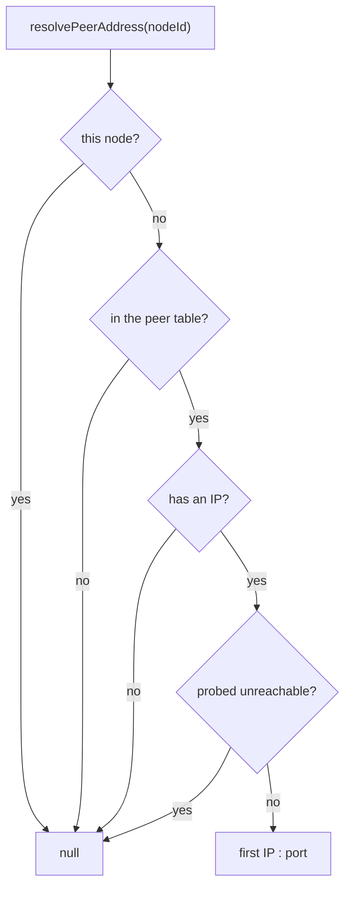

<!--
@license
Copyright (c) rljson

Use of this source code is governed by terms that can be
found in the LICENSE file in the root of this package.
-->

# Resolve the address of any peer

## Motivation

- `NetworkManager` already tells an application where the hub is: the
  topology carries `hubAddress` as `"ip:port"`
- For every other node it gave out the peer list, but no address. Each
  application had to build one from `localIps` and `port` itself, and had
  to decide on its own which peers were worth a try
- An application that wants to reach one particular peer directly, not
  only the hub, needs the same kind of answer the hub gets: one address,
  built one way, or a clear "no"
- A configured hub (`static.hubAddress`) is known by a stand-in node id.
  Pinning it with `assignHub` meant copying the static layer's naming

## Strategy

- One public method, `resolvePeerAddress(nodeId)`, next to the hub address
  logic in `NetworkManager`
- Build the address exactly like the hub address: first IP, then the port
- Use only what the manager already knows, the peer table and the probe
  results; no new network traffic
- Answer `null` whenever a connect cannot work, so the caller has one check
  instead of four
- Export the static layer's naming as a function, instead of a string each
  caller rebuilds

## Implementation 1: `resolvePeerAddress`

- Returns `"ip:port"` for a known peer, e.g. `'10.0.0.7:3000'`
- Returns `null` for this node itself, for a node the peer table does not
  know, for a peer that announced no IP, and for a peer the probes found
  unreachable
- Also `null` before `start()`: the peer table is still empty
- A peer not probed yet counts as reachable, the same rule the hub election
  uses for nodes without probe data
- Exclusion from the election plays no part: it is about the hub role, not
  about reaching a node
- Tests cover each case: a reached peer, an unreachable one, no IP, an
  unknown id, the node itself, and a manager that has not started

## Implementation 2: `staticHubNodeId`

- `staticHubNodeId(hubAddress)` returns the node id the static layer gives
  a configured hub: `static-hub-<ip:port>`
- The static layer now uses this function itself, so the name and its use
  cannot drift apart
- Exported from the package root, to pin the configured hub with
  `NetworkManager.assignHub(staticHubNodeId(address))`

## Implementation 3: Docs

- `README.public.md` shows the call in the usage example
- `README.architecture.md` lists the method and its rules under
  `NetworkManager`
- `CHANGELOG.md` names both additions under `[Unreleased]`
- A new `index.jsonc` gives a short overview of the package, its domain and
  its API, for readers and tools

## Open Points

- Only the first IP is used, as for the hub. A peer whose first IP cannot
  be reached from here, while a second one could, gets an address that fails
- An unprobed peer counts as reachable. With probing off, or before the
  first probe round, the caller may get an address that does not answer and
  must handle a failed connect
- The answer is a snapshot. Peers move and probes change: ask again before
  each connect instead of keeping the address
