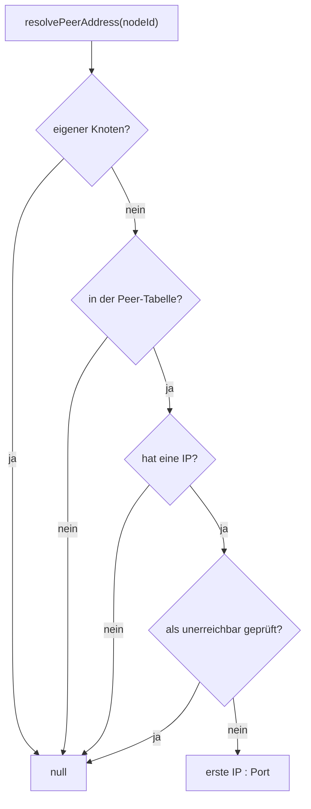

<!--
@license
Copyright (c) rljson

Use of this source code is governed by terms that can be
found in the LICENSE file in the root of this package.
-->

# Die Adresse jedes Peers auflösen

## Motivation

- `NetworkManager` sagt einer Anwendung schon, wo der Hub ist: die Topologie
  enthält `hubAddress` als `"ip:port"`
- Für alle anderen Knoten gab es nur die Peer-Liste, aber keine Adresse.
  Jede Anwendung musste sie selbst aus `localIps` und `port` bauen und
  selbst entscheiden, welche Peers einen Versuch wert sind
- Eine Anwendung, die einen bestimmten Peer direkt erreichen will, nicht
  nur den Hub, braucht dieselbe Art Antwort wie beim Hub: eine Adresse, auf
  eine Weise gebaut, oder ein klares „nein“
- Ein konfigurierter Hub (`static.hubAddress`) hat eine Ersatz-Node-ID. Wer
  ihn mit `assignHub` festlegen wollte, musste die Namensbildung des
  Static-Layers nachbauen

## Strategie

- Eine öffentliche Methode, `resolvePeerAddress(nodeId)`, direkt neben der
  Logik für die Hub-Adresse in `NetworkManager`
- Die Adresse genau wie die Hub-Adresse bauen: erste IP, dann der Port
- Nur nutzen, was der Manager schon weiß, Peer-Tabelle und Probe-Ergebnisse;
  kein zusätzlicher Netzwerkverkehr
- `null` liefern, sobald eine Verbindung nicht klappen kann, damit der
  Aufrufer eine Prüfung statt vier braucht
- Die Namensbildung des Static-Layers als Funktion exportieren, statt eines
  Strings, den jeder Aufrufer nachbaut

## Realisierung 1: `resolvePeerAddress`

- Liefert `"ip:port"` für einen bekannten Peer, z. B. `'10.0.0.7:3000'`
- Liefert `null` für den eigenen Knoten, für einen Knoten, den die
  Peer-Tabelle nicht kennt, für einen Peer ohne angekündigte IP und für
  einen Peer, den die Probes als unerreichbar gemeldet haben
- Auch `null` vor `start()`: die Peer-Tabelle ist dann noch leer
- Ein noch nicht geprüfter Peer gilt als erreichbar, nach derselben Regel,
  die die Hub-Wahl für Knoten ohne Probe-Daten nutzt
- Der Ausschluss von der Wahl spielt keine Rolle: er betrifft die Hub-Rolle,
  nicht die Erreichbarkeit eines Knotens
- Tests decken jeden Fall ab: erreichter Peer, unerreichbarer Peer, keine
  IP, unbekannte ID, der eigene Knoten und ein nicht gestarteter Manager

## Realisierung 2: `staticHubNodeId`

- `staticHubNodeId(hubAddress)` liefert die Node-ID, die der Static-Layer
  einem konfigurierten Hub gibt: `static-hub-<ip:port>`
- Der Static-Layer nutzt die Funktion jetzt selbst, damit Name und
  Verwendung nicht auseinanderlaufen
- Aus dem Paket exportiert, um den konfigurierten Hub mit
  `NetworkManager.assignHub(staticHubNodeId(address))` festzulegen

## Realisierung 3: Dokumentation

- `README.public.md` zeigt den Aufruf im Anwendungsbeispiel
- `README.architecture.md` führt die Methode und ihre Regeln unter
  `NetworkManager` auf
- `CHANGELOG.md` nennt beide Neuerungen unter `[Unreleased]`
- Eine neue `index.jsonc` gibt einen kurzen Überblick über das Paket, seine
  Domäne und seine API, für Leser und Werkzeuge

## Offene Punkte

- Nur die erste IP wird genutzt, wie beim Hub. Ist die erste IP eines Peers
  von hier nicht erreichbar, eine zweite aber schon, scheitert die Adresse
- Ein ungeprüfter Peer gilt als erreichbar. Ohne Probing oder vor der
  ersten Probe-Runde kann der Aufrufer eine Adresse bekommen, die nicht
  antwortet, und muss einen fehlgeschlagenen Verbindungsaufbau abfangen
- Die Antwort ist eine Momentaufnahme. Peers wandern, Probes ändern sich:
  vor jeder Verbindung neu fragen, statt die Adresse zu behalten
